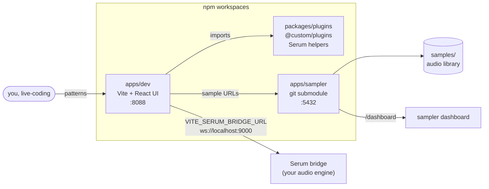

# strudel-dev-vite

**A Strudel live-coding workbench as a public npm-workspace monorepo**: a
hot-reloading Vite REPL UI (`apps/dev`), a publishable Serum-voice plugin
(`@toxicwind/strudel-serum`), and a sample-server microservice
(`apps/sampler`, submodule).

## Packages

| Path | Package | Role |
|------|---------|------|
| `packages/serum` | **`@toxicwind/strudel-serum`** | Serum-style voice/filter pattern functions + WebSocket bridge, published to npm (`npm run publish:serum`, auto-on `serum@*` tag via CI) |
| `apps/dev` | strudel-vite workbench | `<strudel-editor>` REPL running `@strudel/repl`, hot-reload on `:8088` |
| `apps/sampler` | sampler submodule | serves `samples/` to the REPL via `samples('http://localhost:55432')` |

## Clone (submodules need HTTPS, not `git@`)

```bash
git clone https://github.com/toxicwind/strudel-dev-vite.git
cd strudel-dev-vite
git submodule update --init --recursive
npm install
npm run dev           # REPL workbench on :8088
```

An unrelated Git history note: this repo is NOT a fork of upstream
`uzu/strudel` (Codeberg) — it adopts the strudel ecosystem/`@strudel/*` packages
as dependencies rather than sharing ancestry, so integration is npm-based, not a
`git merge upstream`.

[](https://github.com/toxicwind/strudel-dev-vite/actions)


## Why this exists

Strudel live-coding usually means juggling three things at once: a place to write patterns, somewhere to host your sample library, and the audio plumbing in between. **strudel-dev-vite** wires all three together — experiment with patterns in the browser, serve your samples from the bundled microservice, and share the plugin helpers across every project you build on top.

Built for Strudel performers and tinkerers who want a fast local loop: edit, hear it, ship it.

## Features

- 🎛️ **Dev UI on `:8088`** — Vite + React 19 with hot reload; loaded plugins are exposed on `window.__serumPlugins` for console experimentation
- 🔌 **Serum bridge wiring** — `initSerumBridge()` connects the UI to your audio engine over WebSocket, configurable via `VITE_SERUM_BRIDGE_URL`
- 🥁 **Sampler microservice built in** — the production [`strudel-sampler-server-vite`](https://github.com/toxicwind/strudel-sampler-server-vite) repo is vendored as a git submodule and serves sample metadata plus a dashboard on `:5432`
- 📦 **Plugin kit (`@custom/plugins`)** — reusable Strudel helpers (Serum, filter builders) built as a versioned library with type declarations
- ✅ **Bridge-independent smoke test** — the Playwright suite proves plugins load and emit events with the Serum bridge fully offline
- 🐳 **Docker multi-stage build** — ships the dev bundle on `:8088` with the compiled sampler alongside
- 🧪 **CI on every push and PR** — workspace build, Playwright suite, sampler build, and a Docker build, all green or it doesn't land

## How it fits together



## Quick start

```bash
git clone --recurse-submodules git@github.com:toxicwind/strudel-dev-vite.git && cd strudel-dev-vite
npm install
npm run dev
```

Open <http://localhost:8088> and start patterning. In a second terminal, serve your sample library:

```bash
PORT=5432 npm run sampler
```

> If you cloned without `--recurse-submodules`, run `git submodule update --init --recursive` once to fetch `apps/sampler`. The repo ships an empty `samples/` directory (git-ignored) — drop your audio library there or point `STRUDEL_SAMPLES` elsewhere.

## Architecture

| Path | What it is | Entry point |
| --- | --- | --- |
| `apps/dev/` | Browser shell: loads plugins, connects the Serum bridge | `apps/dev/src/main.ts`, `init-bridge.ts` |
| `packages/plugins/` | Reusable Strudel plugin helpers (`@custom/plugins`) | `packages/plugins/src/index.ts` |
| `apps/sampler/` | Sampler microservice + Vite middleware (submodule) | `apps/sampler/sampler-server.ts` |
| `tests/e2e/` | Playwright smoke coverage | `tests/e2e/strudel.spec.ts` |
| `samples/` | Your audio library (git-ignored, never committed) | — |

The dev UI loads `@custom/plugins` and exposes them on `window.__serumPlugins` / `window.__serumPluginKeys`, then calls `initSerumBridge()` with the configured bridge URL. If the bridge is down, the UI still works — the smoke test covers exactly that case.

## Configuration

Copy `.env.example` to `.env` to override defaults:

| Variable | Default | Used by |
| --- | --- | --- |
| `VITE_SERUM_BRIDGE_URL` | `ws://localhost:9000` | Dev UI → Serum bridge WebSocket |
| `STRUDEL_SAMPLER_URL` | `http://localhost:5432/strudel-samples` | Scripts/tests pointing at a sampler |

Sampler-specific variables live in the submodule (`apps/sampler/.env.example`):

| Variable | Default | Meaning |
| --- | --- | --- |
| `PORT` | `5432` | Sampler HTTP port (dashboard at `/dashboard`) |
| `STRUDEL_SAMPLES` | `./samples` | Audio library root |
| `CACHE_TTL` | `3600000` | Metadata cache TTL (ms) |
| `CACHE_MAX_SIZE` | `500` | Metadata cache entries |
| `HOT_RELOAD` | `true` | Pick up new samples without restart |

## Development

| Command | What it does |
| --- | --- |
| `npm run dev` | Start the Strudel dev UI (Vite, strict port `8088`) |
| `npm run build` | Build plugins library + dev bundle for production |
| `npm run type-check` | `tsc --noEmit` across all workspaces |
| `npm run test` / `npm run test:e2e` | Headless Playwright smoke test (no bridge needed) |
| `npm run sampler` | Launch the sampler microservice via `tsx` |
| `npm run sampler:dev` | Sampler in Vite middleware mode (dashboard tweaks) |
| `npm run sampler:build` | Compile the sampler to `apps/sampler/dist` |
| `npm run preview` | Preview the production dev-bundle build |
| `npm run clean` | Remove build and dependency artifacts |

Full check before pushing:

```bash
npm run build && npm run type-check && npm run test
```

Or ship the whole thing as a container:

```bash
docker build -t strudel-dev-vite .
docker run -p 8088:8088 strudel-dev-vite
```

## Sample library tips

- Follow Strudel's folder conventions so subdirectories become sample names (`samples/drums/bd`, `samples/fx/risers`) — then `s("bd sd")` just works.
- Group drum kits and sound families for predictable `bank` switching (e.g. `samples/drums/roland-tr-909/bd/*.wav`); park multi-sampled instruments under one prefix like `samples/keys/wurlitzer/`.
- After adding files, open the sampler dashboard (`http://localhost:5432/dashboard/`) to confirm metadata, categories, and waveform previews before a session.

## License and security

- **License:** no license file has been added yet — treat the contents as all-rights-reserved until one is.
- **Security:** no secrets are committed to this repo. Local overrides belong in `.env` (git-ignored); `.env.example` documents the shape. Your audio in `samples/` never leaves your machine unless you deploy it yourself.
